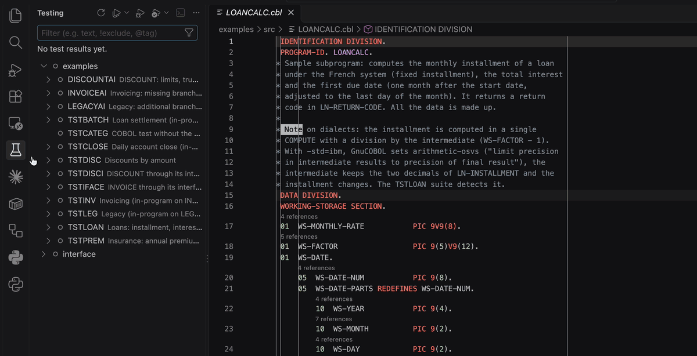

# Cobalto for VS Code

Run, measure and debug COBOL unit tests without leaving the editor. This is the VS Code extension for [Cobalto](https://github.com/abstracta/cobalto#readme), the open source unit testing tool for COBOL by [Abstracta](https://abstracta.us).



## Features

| Feature | What you get |
|---|---|
| Test Explorer | The suites and their test cases in the Testing view. Run the whole project or one suite; a failing case shows expected and actual as a diff |
| Coverage | Executed and non-executed statements in the gutter, entries per paragraph, and statements, branches and paragraphs in VS Code's Test Coverage view |
| Debugging in COBOL terms | Breakpoints in the suite and in the program under test, one step per COBOL statement, fields shown with their COBOL names and values formatted by their PIC, conditions written in COBOL, and values changed from the variables panel |
| Another compiler in one click | The status bar shows the profile the suites run with; one click switches it and offers to run the suites again. Same tests, another dialect |
| Syntax for `.cblt` files | Highlighting for the suite language on top of COBOL, and folding per test case |

Verified on macOS arm64 with GnuCOBOL 3.2, the `lldb-dap` that ships with Xcode and VS Code 1.147.

## Requirements

- A Cobalto project: a folder with `cblt.json` and the suites (`cobalto init` creates `cblt.json`, `src/` and `tests/`).
- The Cobalto CLI installed (see [Installation](#installation) and the [reference](https://github.com/abstracta/cobalto/blob/main/docs/reference.md)). The extension looks for the `cobalto` executable in this order: the `cobalto.cliPath` setting, a virtual environment (`.venv`) in the project folder or in one above it, and the `PATH`.
- To debug: GnuCOBOL and `lldb-dap`. On macOS it comes with Xcode or with the Command Line Tools (`xcrun -f lldb-dap`); on Linux, with the `lldb` package of LLVM 18 or later. The path can be set in `cobalto.lldbDapPath`; the `lldb-dap.executable-path` setting of LLVM's LLDB DAP extension is honored too.
- Recommended: a COBOL extension (for example `bitlang.cobol`) to highlight the `.cbl` files and to set breakpoints in them from the gutter. Cobalto only registers breakpoints for `.cblt` files, so as not to conflict with those extensions.

## Installation

Search for "Cobalto" in the Extensions view. The extension is on the [Visual Studio Marketplace](https://marketplace.visualstudio.com/items?itemName=abstracta.vscode-cobalto) and on [Open VSX](https://open-vsx.org/extension/abstracta/vscode-cobalto), where Cursor, VSCodium and other editors built on VS Code look for extensions. From a terminal:

```bash
code --install-extension abstracta.vscode-cobalto
```

The extension runs the Cobalto CLI, which is installed separately. It needs Python 3.9 or later and, to run the suites on your machine, GnuCOBOL 3.x. From a clone of the [repository](https://github.com/abstracta/cobalto), in a virtual environment:

```bash
python3 -m venv .venv
source .venv/bin/activate
python3 -m pip install .
```

The extension finds that `.venv` by itself when the project is the clone or a folder inside it; for a project elsewhere, set `cobalto.cliPath` to the `cobalto` executable inside it.

On macOS, if `code` is not on the PATH, use `"/Applications/Visual Studio Code.app/Contents/Resources/app/bin/code"`.

The extension activates by itself when a folder that contains a `cblt.json` is opened (in subfolders too: if there are several projects, the Test Explorer shows them separately).

## Usage

### Test Explorer

Open the Testing view (beaker icon). The suites appear with their `TESTSUITE` identifier and their description; each `TESTCASE` with its name, and the `IGNORE` ones marked. The list comes from the CLI (`cobalto list --json`), so it is what the CLI will run; a suite file with a syntax error shows up with its error instead of disappearing. Running everything runs `cobalto test --coverage`; running one suite adds `--filter SUITE`. A failing test case shows the message of the assert with expected and actual as a diff; if the CLI stops before running (a compile error, for example), the test cases show that error and not the results of an earlier run; the `DISPLAY` output goes to the Test Results tab. The full output of the CLI goes to the "Cobalto" output channel.

The "Run with coverage" profile does the same and also loads `build/lcov.info` into VS Code's Test Coverage view (by statement, branch and paragraph).

Palette commands: "Cobalto: Run the suites (cobalto test --coverage)" and "Cobalto: Reload the suites". The `.cblt` and `.cbl` files are read again by themselves when they change.

### Coverage in the gutter

"Cobalto: Show or hide coverage in the gutter" (also from the status bar item, which shows covered statements over the total of the active file). It paints the executed statements green and the non-executed ones red, and next to each paragraph it shows how many times it was entered ("1 entry", "3 entries") or "paragraph not executed". It reads `build/lcov.info` of the project the file belongs to; the suites must have been run with `--coverage` (the Test Explorer always does). The command is a toggle and reports in the status bar which state it ended in. The background colors are changed with `cobalto.coverage.colors.covered` and `.uncovered`.

In the Test Coverage view each file carries three unlabeled bars, in this order: statements, branches and paragraphs; the tooltip of the row names them with VS Code's own words ("statements", "branches", "functions covered"): the "functions" are the paragraphs, and that word cannot be changed from the extension. When a file is opened from that view, VS Code marks the lines with branches not taken and the tooltip of the line says which ones.

Living with Coverage Gutters (`ryanluker.vscode-coverage-gutters`), which paints the same `lcov.info`: with `cobalto.coverage.margin` set to `auto` (the default), if that extension is installed Cobalto stops filling the lines and keeps what Coverage Gutters does not have, the entries per paragraph and the counter in the status bar; `cobalto` forces everything, `entriesOnly` forces that split and `off` turns off Cobalto's gutter.

### Debugging a suite

1. Set a breakpoint on a COBOL statement: in the `.cblt` (inside a `TESTCASE` or `BEFORE-EACH`), in the program under test (`src/INVOICE.cbl`, even in an in-program suite: the breakpoint is moved to the copy `build/TSTINV.cbl`) or in a program called with `CALL`.
2. "Cobalto: Debug suite" (palette, or F5 without a `launch.json`) and choose the suite. The extension runs `cobalto debug --suite X`, which compiles with `-g` and leaves the maps in `build/`, and launches the session. That CLI command also leaves in `.vscode/launch.json` the configuration "Cobalto: debug X" (type `cobalto`) to repeat with F5 from "Run and Debug"; the "(plain lldb-dap)" and "(CodeLLDB)" variants are for debugging without this extension and do not understand the breakpoints of the `.cblt`.
3. At the stop: the editor shows the `.cblt` or the original program, not the generated copy; `Globals` is the `WORKING-STORAGE` of the stopped program with COBOL names and formatted values (`0002000.00`, `"PREMIUM   "`), with the groups expandable down to all their subordinate fields (also those the program does not use), the `OCCURS` expandable occurrence by occurrence (`WS-ITEM(1)`, `WS-ITEM(2)`, …) and a "(C bytes: b_NNN)" entry with the raw static; `Locals` are the `LINKAGE` parameters. The internals of GnuCOBOL (`module`, `d_0`, `frame_*`) are grouped under "(GnuCOBOL internals)". The type of each field shows its PIC, usage, size and offset.
4. *Step over* (F10) and *step into* (F11) go to the next COBOL statement; *step out* returns to the caller on a COBOL line. In the stack, the frames of the generated C and of libcob appear dimmed and labeled ("(generated C)", "(libcob)").
5. In the debug console, in the Watch panel ("+" and type the name) or by hovering over a field, any COBOL name of the stopped program can be evaluated (`WS-TOTAL`, `ln-amount`), including subfields that do not appear at the first level of the panel and occurrences with subscripts (`WS-ITEM(3)`, `WS-CELL(1, 2)`).
6. Changing a value: double-click the value in the variables panel (a field, an occurrence or an 01) and type the new one (`1234.5`, `PREMIUM`, `-7`). It is written to the memory of the process with the encoding of the field (DISPLAY, COMP-3, COMP, …); a value that does not fit in the PIC, or a negative one in an unsigned field, is rejected with a message.
7. Conditional breakpoints with the condition in COBOL: right-click the breakpoint, "Edit Breakpoint…", and for example `WS-NET > 1000 AND LN-CATEGORY = 'PREMIUM'` (comparisons `= <> > < >= <=` or `EQUAL TO`, `GREATER THAN`, `LESS THAN`, `NOT`, `AND`, `OR`, parentheses, subscripts). The extension evaluates it on every pass and only stops when it is true; a condition written in C (`b_32[0] == '1'`) goes to lldb as is. Hit count conditions and logpoints go to lldb as usual. The extension registers an expression provider for `.cblt` and for the COBOL language ids of the usual extensions (`COBOL`, `cobol`, `BITLANG-COBOL`, `ACUCOBOL`, `COBOLIT`), because without it VS Code cuts the names at the hyphens (`WS-C-AMOUNT` becomes `AMOUNT`) and the hover shows nothing. The hover works in the file of the active frame of the stack; in another open file, use Watch or the console.

Equivalent `launch.json`:

```json
{
  "type": "cobalto",
  "request": "launch",
  "name": "Cobalto: debug TSTINV",
  "suite": "TSTINV",
  "cwd": "${workspaceFolder}"
}
```

Attributes: `suite` (required unless `"prepare": false`, which reuses the last `cobalto debug`), `program` (`build/cbltdrv` of the project by default), `cwd` (the folder with `cblt.json`), `lldbDapPath`, `initCommands`, `env`, `stopOnEntry`, `formatValues` (`false` shows bytes without asking for the formatted value).

### Settings

| Setting | Default | Purpose |
|---|---|---|
| `cobalto.cliPath` | empty | path to the `cobalto` executable (relative paths start at the project folder); empty looks in a `.venv` and then in the `PATH` |
| `cobalto.lldbDapPath` | empty | path to `lldb-dap` if it is not found by itself |
| `cobalto.debug.adapterMode` | `inline` | `process` runs the proxy as a separate process (`out/dap-proxy.js`), the same binary the verification over stdio uses |
| `cobalto.debug.formatValues` | `true` | ask libcob for the formatted value of each field (one evaluation per field) |
| `cobalto.debug.maxFormattedFields` | `200` | above this number, bytes are shown |
| `cobalto.profile` | empty | `cblt.json` profile the suites run with from the Test Explorer (`--profile`); empty is the project's default profile. It is chosen with "Cobalto: Choose the compiler (cblt.json profile)" or with a click on "Cobalto: <profile>" in the status bar |
| `cobalto.coverage.showOnStart` | `false` | show coverage when the project is opened |
| `cobalto.coverage.margin` | `auto` | what Cobalto paints: `auto` (everything, or only the entries per paragraph if Coverage Gutters is installed), `cobalto`, `entriesOnly`, `off` |
| `cobalto.coverage.colors.covered` | `rgba(166, 220, 142, 0.45)` | background of the executed statements |
| `cobalto.coverage.colors.uncovered` | `rgba(255, 88, 88, 0.45)` | background of the non-executed statements |

## If the breakpoint does not hit

- After installing or updating the extension, reload the window (Developer: Reload Window): an open window keeps running the previous version.
- Check that the session is of type `cobalto`: the status bar and the debug console say "Cobalto: debug X", and the "Cobalto" output channel shows lines `[dap] launch: ... line map yes`. If "(plain lldb-dap)" or "(CodeLLDB)" was launched, the breakpoints of the `.cblt` are not moved.
- A gray breakpoint in the `.cblt` with a message on hover: `build/X.lines.json` is missing or the configuration does not set `suite`; run `cobalto debug --suite X` with the current CLI or use the "Cobalto: Debug suite" command.
- If the window has a parent folder open (for example the root of this repository) and not the project folder, the `launch.json` in the project's `.vscode/` does not apply; use the "Cobalto: Debug suite" command (it picks the project and the suite) or open the project folder.
- The hover over a field only appears in the file of the frame selected in the stack (a VS Code rule); for another file, use Watch or the debug console.
- The breakpoint has to be on a statement (inside a `TESTCASE`, `BEFORE-EACH` or a paragraph), not on `TESTSUITE`, `PROGRAM` or a `WORKING-STORAGE` line.

## Known limits

- CodeLLDB as the underlying adapter is not verified: the proxy was only tested on top of lldb-dap.
- On Linux, the debug adapter is verified over the protocol in the container, not with VS Code running on Linux.
- Groups with `SYNC` and padding fall back to the earlier mode (only the fields with a descriptor).
- Data breakpoints (watchpoints) on COBOL fields are not supported.
- The highlighting of the `.cbl` files and the breakpoints in them depend on an installed COBOL extension.

## Contributing

How the debug adapter works, how the extension is verified and how to build it from source are in [DEVELOPMENT.md](https://github.com/abstracta/cobalto/blob/main/vscode-cobalto/DEVELOPMENT.md). Problems and ideas go to the [issues](https://github.com/abstracta/cobalto/issues) of the repository.
